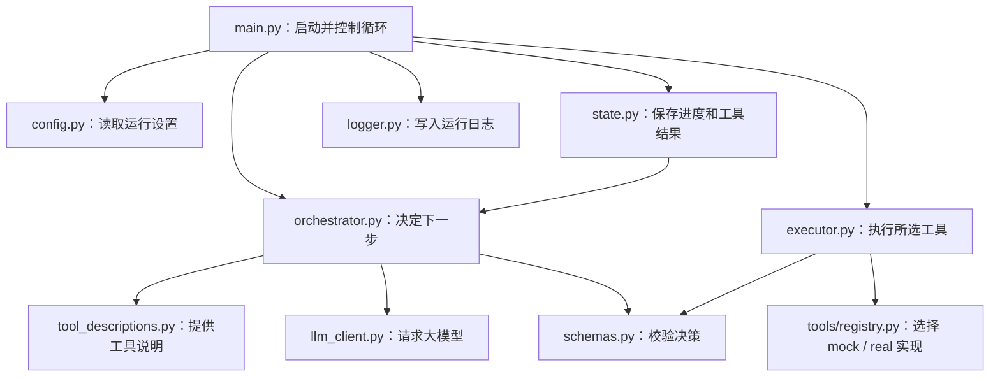

# Agent 核心与运行目录说明

`agent/` 负责接收任务、让大模型选择下一步、执行工具，并保存运行状态和日志。具体的视频检索、重建、编辑、仿真和模仿学习训练由 `tools/` 与 `mcp_servers/` 实现。

当前目录共有 10 个 Python 文件：

| 文件 | 主要做什么 | 会调用什么功能 |
|---|---|---|
| [`__init__.py`](../agent/__init__.py) | 将目录标记为 Python 包，当前文件为空。 | 没有业务调用。 |
| [`main.py`](../agent/main.py) | Agent 的启动入口和主循环。接收任务，反复执行“决策 → 调工具 → 保存结果”，直到完成、停止或达到步数上限。 | 调用配置加载、决策器、工具执行器、状态管理和日志记录。 |
| [`orchestrator.py`](../agent/orchestrator.py) | 让大模型根据任务和已有结果决定下一步。主提示词也在这里，包括失败后如何重试或修改方案。 | 获取工具说明和当前状态，调用 LLM 客户端，再校验模型返回的决策；格式错误时请求模型纠正。 |
| [`executor.py`](../agent/executor.py) | 根据工具名称和参数执行一次调用，按配置选择 `mock` 或 `real`。将异常或不合法的返回值整理成统一错误结果。 | 调用 `tools/registry.py` 中的工具注册表，再调用 `schemas.py` 检查返回格式。 |
| [`state.py`](../agent/state.py) | 保存本次任务的进度，包括任务内容、决策历史、工具结果、当前阶段和完成状态。 | 供主循环更新和决策器读取；发送给模型前，会将实例发现结果中的完整逐帧记录缩成采样信息。 |
| [`schemas.py`](../agent/schemas.py) | 检查决策和工具返回的公共格式，例如工具名是否有效、参数是否为对象、错误信息是否齐全。 | 提供 `validate_decision()` 和 `validate_tool_result()`，分别供决策器和执行器使用。工具的具体业务参数由工具层处理。 |
| [`llm_client.py`](../agent/llm_client.py) | 统一连接大模型接口，发送消息并取回回复，同时记录最近一次请求的用量信息。 | 读取本地密钥及模型配置，通过 OpenAI SDK 调用兼容的 Chat Completions 接口。主决策器和纯文本 LLM 工具可使用它。 |
| [`config.py`](../agent/config.py) | 读取并检查 Agent 的运行设置，包括最大步数、决策格式纠错次数、各工具模式和日志目录。 | 读取 `configs/agent.json`，获取工具清单，检查是否漏配工具、配置未知工具或使用非法模式。 |
| [`tool_descriptions.py`](../agent/tool_descriptions.py) | 汇总主 Agent 能看到的工具说明。每个工具的详细说明放在它自己的目录里，这里只负责集中提供清单。 | 导入各工具的 `description.py`，通过 `get_tool_descriptions()` 返回当前 13 个工具的说明。 |
| [`logger.py`](../agent/logger.py) | 将每次运行和每次工具调用保存到日志文件，便于查看输入、输出、耗时和最终结果。 | 由主循环调用，在配置的日志目录下写入 `run.json`、`agent.jsonl`、`final_state.json`，以及各工具的输入、输出和执行记录。 |

## 整体调用关系



正常决策有三种：`call_tool` 调用工具；`finish` 表示任务完成；`stop` 表示遇到无法解决的阻碍，以失败状态结束。

失败后是否重试、改计划或换参数，由主 Agent 在下一轮决策中判断。相关规则位于 `orchestrator.py` 的主提示词中；最大执行步数由 `main.py` 控制。

## 想修改功能时看哪里

- 修改主 Agent 的行为、步骤选择或恢复规则：看 `orchestrator.py`。
- 修改任务的执行循环或结束方式：看 `main.py`。
- 修改模型连接、模型参数的读取方式：看 `llm_client.py`；常用配置填写在 `configs/agent.json`。
- 修改工具本身的说明或能力：看对应的 `tools/toolXX_*/`；新增工具还需更新说明汇总、工具注册表、运行配置及阶段映射。
- 修改状态记录或日志内容：分别看 `state.py` 和 `logger.py`。

## configs/：运行配置

`configs/` 保存 Agent 的非敏感运行设置。目前只有 [`agent.json`](../configs/agent.json)，用来决定使用什么模型、每个工具以什么模式执行，以及日志保存在哪里。

| 配置部分 | 主要做什么 | 由谁读取 |
|---|---|---|
| `agent.max_steps` | 设置一次任务的最大决策步数，当前为 20。 | `agent/config.py` 加载，`agent/main.py` 控制循环。 |
| `llm` | 设置模型接口、模型名称、请求超时、回复长度，以及纯文本 LLM 工具可选的模型角色。 | `agent/llm_client.py`；角色设置由 `tools/llm_runtime.py` 使用。 |
| `orchestrator.decision_correction_attempts` | 设置模型决策格式不合法时允许纠正几次，当前为 1；不是工具失败后的重试次数。 | `agent/config.py` 加载，传给 `agent/orchestrator.py`。 |
| `tools.modes` | 为每个工具选择 `mock`（模拟结果）或 `real`（实际执行），当前 13 个工具均配置为 `real`。 | `agent/config.py` 加载，传给 `agent/executor.py`。 |
| `logging.root_dir` | 设置日志目录，当前为项目根目录下的 `logs/`。 | `agent/config.py` 解析路径，传给 `agent/logger.py`。 |

密钥保存在本地 `.env`。各 MCP 组件自己的设置放在对应的 `mcp_servers/` 子目录；三个纯文本 LLM 工具也各有自己的 `config.json`。

## logs/：运行记录

`logs/` 保存运行过程与测试报告，方便了解 Agent 选择了什么步骤、给工具传了什么参数，以及执行结果。普通 Agent 运行日志由 `agent/logger.py` 写入，测试脚本会另外保存各自的报告。

一次普通运行的目录结构如下：

```text
logs/
└── run_时间戳/
    ├── run.json              # 任务、模型、工具模式、起止时间和状态
    ├── agent.jsonl           # 每一步选择的动作、工具和理由
    ├── final_state.json      # 最终状态及完整执行历史
    └── tools/
        └── step_00_工具名/
            ├── input.json    # 传给工具的参数
            ├── output.json   # 工具返回的结果
            └── execution.log # 工具执行起止、耗时等记录
```

排查问题时，先看 `agent.jsonl` 了解步骤选择，再查看对应工具的 `input.json` 和 `output.json`；最终是否完成及错误信息可看 `final_state.json`。

`logs/` 还可能包含测试报告和开发备份，因此不是所有子目录都采用上面的结构。整个目录已被 Git 忽略，不随源码上传。

项目整体结构见 [ARCHITECTURE.md](ARCHITECTURE.md)，纯文本 LLM 工具规范见 [LLM_TOOLS.md](LLM_TOOLS.md)。

各后端提供哪些工具、如何衔接主 Agent，见 [MCP 组件与工具接入说明](MCP_SERVERS.md)。
