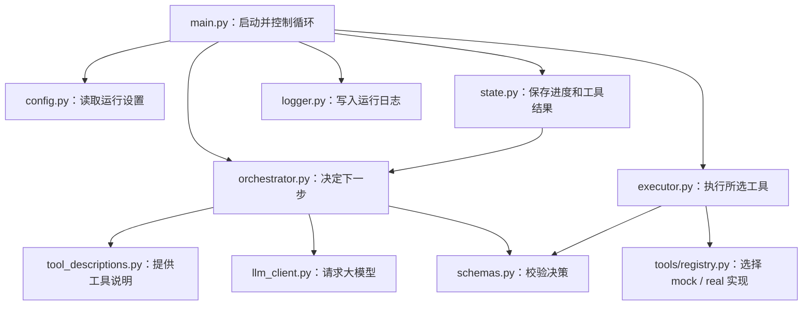

# adagent 项目结构与分工

## 当前范围

当前预留 10 个工具编号，启用 9 个工具、4 个后端组件。攻击车、自车编辑后端已接入；新增快速粗规划与原生 WE 回放入口。原独立视觉验收已直接删除。
原生回放需要目标版本的原生场景包。冻结 metadata 和专家 CSV 到仿真/训练格式的导出仍需接通；不把 mock 或接口测试当作全链路验证。

## 主流程

```text
用户任务
→ 主 LLM 根据工具说明和执行历史选择动作
→ ToolExecutor 调用工具并校验结果
→ 记录状态、产物、错误
→ 主 LLM 决定继续、修正、完成或停止
```

主 Agent 根据任务选择工具，tool04 可筛掉不适合的检索场景；tool05/06 内部负责具体轨迹求解。
原生回放与策略闭环仿真分别通过 tool07、tool08 执行，格式转换放在适配层，不再单独占工具。

## 顶层目录

| 目录/文件 | 职责 |
|---|---|
| agent/ | LLM 决策循环、执行器、状态和日志 |
| common/ | 不依赖 Agent 或 Tool 的通用模型、场景引用和结果引用读取 |
| tools/ | 10 个工具的说明、Schema、real 与 mock 入口 |
| mcp_servers/ | 四个后端的独立核心与 AdAgent 适配 |
| configs/agent.json | 最大步数、工具模式、LLM 角色 |
| configs/api.json | Kimi 与检索 API 的非敏感配置 |
| api_config.py | 统一解析 API profile 与密钥变量 |
| environments/ | 主 Agent 和各服务环境，不进入 Git |
| data/ | 场景、标注、高斯资产和地图，不进入 Git |
| logs/ | 主 Agent 决策、工具记录和运行状态，不进入 Git |
| tests/ | 编排、工具契约、服务和数据衔接测试 |
| scripts/ | 自动生成工具接口文档 |
| docs/ | 项目结构、接口和运行说明 |

## agent/ 文件职责

| 文件 | 职责 |
|---|---|
| main.py | 创建一次运行，循环决策、执行和写日志 |
| prompt.md | 主 Agent 的调度、完成与纠错规则 |
| orchestrator.py | 加载主提示词、工具选择、决策 JSON 校验与格式纠正 |
| executor.py | 根据配置选择 real/mock，将异常转换成标准错误 |
| state.py | 任务、阶段、调用历史和运行状态 |
| schemas.py | 通用决策和工具结果 envelope 校验 |
| tool_descriptions.py | 汇总各工具的 description.py |
| llm_client.py | 解析统一模型配置并发送请求 |
| config.py | 校验运行配置和工具模式 |
| logger.py | 每步日志、调用追踪和状态快照 |

主 LLM 每次看到原始任务、精简工具目录和当前历史。目录保留完整输入 Schema（含嵌套约束），省去重复字段说明与输出 Schema，输出只列字段名，传递语义在 handoff 维护；工具内部 prompt 不重复注入。
完整工具输入输出写入日志；每个历史结果附 result_ref。编辑阶段可传该绝对 JSON 路径，适配层读取完整数据并按原有 Schema 校验；历史中相同版本的大对象参数可改为引用，错误反馈保留。
参数由主 LLM 从已有结果中组装，Schema 验证类型与必填字段。状态快照支持检查，不等于自动续跑。
恢复决策由主 Agent 作出；当前没有独立长期记忆库，也没有针对全部工具的自动质量检查器。

## tools/ 当前工具

| 编号 | 工具 | 职责 |
|---|---|---|
| 01 | failure_analyzer | 分析已有失败场景与证据 |
| 02 | scene_instance_generator | 生成目标场景、全局自车目标与三个候选 |
| 03 | video_retriever | 检索并强制绑定多相机场景、标注和资产 |
| 04 | edit_planner | 快速判断可编辑性，给出针对底场景的粗计划 |
| 05 | attack_vehicle_editor | 规划、搜索、编辑并冻结攻击车场景 |
| 06 | ego_trajectory_editor | 规划、编辑并复核正确的自车专家轨迹 |
| 07（未启用） | scene_replayer | 用 WE 原生轨迹回放输出相机视频 |
| 08 | policy_runner | 执行 PDM 挑战或驾驶策略闭环仿真 |
| 09 | failure_case_filter | 读取官方评分并筛选失败案例 |
| 10 | policy_trainer | 执行 ILFT/RLFT 并输出模型与更新审计 |

每个工具保留 description.py、schemas.py、real.py、mock.py；tool02/04 另有内部提示词和 LLM 配置。
可执行契约与字段说明见 INTERFACES.md，不在多个文档重复维护参数默认值。

## mcp_servers/ 分层

| 服务 | core 职责 | adapter 职责 |
|---|---|---|
| sentry_video_search | 视频索引、召回、重排序、原生 CLI | 解释器隔离、公共入口、多相机场景绑定 |
| worldengine_failure_analysis | 取证、分析、原生 CLI 和配置模板 | Agent 调用、路径和运行任务管理 |
| scene_editing | 攻防编辑、候选搜索、检查和既有渲染脚本 | 阶段 JSON 桥、身份与轨迹校验 |
| worldengine | SimEngine、AlgEngine、原生模型与配置 | 仿真启动、PDM 筛选、训练准备与审计 |

调用方向为 Tool → adapter/service.py → core；Tool 与 adapter 可依赖 common，common 不反向依赖它们。core 不导入主 Agent、Tool 或根 api_config。Sentry 由 adapter 显式注入主项目 API profile；WFA 子进程由 adapter 传 --api-config。独立 core 使用自己的配置入口。任务目录与过程追踪在适配层管理。
各服务 runtime/<run_id>/ 包含 manifest.json、input/、logs/、output/。

## 新编辑接入边界

从 tool03.scene_ref 读取原始标注和已有高斯资产，分别对接攻击车编辑与自车专家轨迹编辑。真实后端位于 scene_editing/core/adversarial，PDM 旁路通过 tool08 的 pdm_closed_loop 模式执行，详见[攻防闭环后端接入说明](EDITING_INTERFACES.md)。
冻结场景、专家轨迹和原场景应保留来源及坐标/时间说明。需要转换成原生场景和训练数据后，才交给仿真与后训练。后端未配置时停止，不使用旧编辑转换链路作为隐式替代。

## 配置与协作

.env 只放密钥；API 模型与端点在 configs/api.json；各后端解释器及路径在 adapter/settings.json。
环境是非 Git 运行资源。DGGT 环境仍被数据下载进程使用，暂时保留；旧 SegFormer 和 SmartEdit 环境已清理。

修改工具 Schema 后运行 scripts/generate_interface_docs.py；改注册表时同步工具说明、配置、测试。
通用测试执行 python -m pytest；真实工具测试另需有效数据、外部 API 或 GPU。训练成功不代表指标提升。


---

# Agent 核心与运行目录说明

`agent/` 负责接收任务、让大模型选择下一步、执行工具，并保存运行状态和日志。具体的视频检索、编辑接口、验证、仿真和后训练由 `tools/` 与 `mcp_servers/` 实现。

当前目录有 10 个 Python 文件；主提示词单独保存在 agent/prompt.md：

| 文件 | 主要做什么 | 会调用什么功能 |
|---|---|---|
| [`__init__.py`](../agent/__init__.py) | 将目录标记为 Python 包，当前文件为空。 | 没有业务调用。 |
| [`main.py`](../agent/main.py) | Agent 的启动入口和主循环。接收任务，反复执行“决策 → 调工具 → 保存结果”，直到完成、停止或达到步数上限。 | 调用配置加载、决策器、工具执行器、状态管理和日志记录。 |
| [`orchestrator.py`](../agent/orchestrator.py) | 让大模型根据任务和已有结果决定下一步。加载 agent/prompt.md 中的调度、完成与纠错规则。 | 获取工具说明和当前状态，调用 LLM 客户端，再校验模型返回的决策；格式错误时请求模型纠正。 |
| [`executor.py`](../agent/executor.py) | 根据工具名称和参数执行一次调用，按配置选择 `mock` 或 `real`。将异常或不合法的返回值整理成统一错误结果。 | 调用 `tools/registry.py` 中的工具注册表，再调用 `schemas.py` 检查返回格式。 |
| [`state.py`](../agent/state.py) | 保存本次任务的进度，包括任务内容、决策历史、工具结果、当前阶段和完成状态。 | 供主循环更新和决策器读取；发送给模型前，将可匹配到原始结果的重复编辑参数替换为 result_ref，并省去攻击结果中重复的 source_scene_ref；完整历史仍保留在日志。 |
| [`schemas.py`](../agent/schemas.py) | 检查决策和工具返回的公共格式，例如工具名是否有效、参数是否为对象、错误信息是否齐全。 | 提供 `validate_decision()` 和 `validate_tool_result()`，分别供决策器和执行器使用。工具的具体业务参数由工具层处理。 |
| [`llm_client.py`](../agent/llm_client.py) | 统一连接大模型接口，发送消息并取回回复，同时记录最近一次请求的用量信息。 | 读取本地密钥及模型配置，通过 OpenAI SDK 调用兼容的 Chat Completions 接口。主决策器和纯文本 LLM 工具可使用它。 |
| [`config.py`](../agent/config.py) | 读取并检查 Agent 的运行设置，包括最大步数、决策格式纠错次数、各工具模式和日志目录。 | 读取 `configs/agent.json`，获取工具清单，检查是否漏配工具、配置未知工具或使用非法模式。 |
| [`tool_descriptions.py`](../agent/tool_descriptions.py) | 汇总主 Agent 能看到的工具说明。每个工具的详细说明放在它自己的目录里，这里只负责集中提供清单。 | 导入各工具的 `description.py`，通过 `get_tool_descriptions()` 提供完整说明，主 Agent 使用 compact=True 保留输入约束与衔接规则，输出仅列字段名，省去重复输出 Schema。 |
| [`logger.py`](../agent/logger.py) | 将每次运行和每次工具调用保存到日志文件，便于查看输入、输出、耗时和最终结果。 | 由主循环调用，在配置的日志目录下写入 `run.json`、`agent.jsonl`、`final_state.json`，以及各工具的输入、输出和执行记录。 |

## 整体调用关系



正常决策有三种：`call_tool` 调用工具；`finish` 表示任务完成；`stop` 表示遇到无法解决的阻碍，以失败状态结束。

失败后是否重试、改计划或换参数，由主 Agent 在下一轮决策中判断。相关规则位于 `agent/prompt.md` 中；最大执行步数由 `main.py` 控制。

## 想修改功能时看哪里

- 修改主 Agent 的行为、步骤选择或恢复规则：看 `agent/prompt.md`；决策调用逻辑看 `orchestrator.py`。
- 修改任务的执行循环或结束方式：看 `main.py`。
- 修改模型连接、模型参数的读取方式：看 `llm_client.py`；API 地址和模型填写在 `configs/api.json`，Agent 运行参数填写在 `configs/agent.json`。
- 修改工具本身的说明或能力：看对应的 `tools/toolXX_*/`；新增工具还需更新说明汇总、工具注册表、运行配置及阶段映射。
- 修改状态记录或日志内容：分别看 `state.py` 和 `logger.py`。

## configs/：运行配置

`configs/` 保存 Agent 的非敏感运行设置。[`api.json`](../configs/api.json) 统一管理 Kimi 与检索 API 的地址、模型和密钥变量名；[`agent.json`](../configs/agent.json) 管理模型 profile 引用、每个工具执行模式以及日志位置。

| 配置部分 | 主要做什么 | 由谁读取 |
|---|---|---|
| `agent.max_steps` | 设置一次任务的最大决策步数，当前为 20。 | `agent/config.py` 加载，`agent/main.py` 控制循环。 |
| `llm` | 引用根 API profile，设置请求预算和纯文本工具模型角色。 | `agent/llm_client.py`；角色设置由 `tools/llm_runtime.py` 使用。 |
| `orchestrator.decision_correction_attempts` | 设置模型决策格式不合法时允许纠正几次，当前为 1；不是工具失败后的重试次数。 | `agent/config.py` 加载，传给 `agent/orchestrator.py`。 |
| `tools.modes` | 为每个工具选择 `mock`（模拟结果）或 `real`（实际执行），当前 9 个已启用工具均配置为 `real`。 | `agent/config.py` 加载，传给 `agent/executor.py`。 |
| `logging.root_dir` | 设置日志目录，当前为项目根目录下的 `logs/`。 | `agent/config.py` 解析路径，传给 `agent/logger.py`。 |

密钥保存在本地 `.env`。各 MCP 组件自己的设置放在对应的 `mcp_servers/` 子目录；tool02 也有自己的 `config.json`。

## logs/：运行记录

`logs/` 保存运行过程与测试报告，方便了解 Agent 选择了什么步骤、给工具传了什么参数，以及执行结果。普通 Agent 运行日志由 `agent/logger.py` 写入，测试脚本会另外保存各自的报告。

一次普通运行的目录结构如下：

```text
logs/
└── run_时间戳/
    ├── run.json              # 任务、模型、工具模式、起止时间和状态
    ├── agent.jsonl           # 每一步选择的动作、工具和理由
    ├── final_state.json      # 最终状态及完整执行历史
    └── tools/
        └── step_00_工具名/
            ├── input.json    # 传给工具的参数
            ├── output.json   # 工具返回的结果
            └── execution.log # 工具执行起止、耗时等记录
```

工具调用写入 output.json 后，logger 返回绝对路径作为历史条目的 result_ref。tool05.scene_ref 可直接接收检索结果的 result_ref，tool06.attack_result 可直接接收攻击编辑结果的 result_ref；适配层读取原文件并校验，避免大模型反复抄写完整对象。不同场景或编辑版本不会共用引用。

排查问题时，先看 `agent.jsonl` 了解步骤选择，再查看对应工具的 `input.json` 和 `output.json`；最终是否完成及错误信息可看 `final_state.json`。

`logs/` 还可能包含测试报告和开发备份，因此不是所有子目录都采用上面的结构。整个目录已被 Git 忽略，不随源码上传。

项目整体结构见 [ARCHITECTURE.md](ARCHITECTURE.md)，纯文本 LLM 工具规范见 [PROMPTS.md](PROMPTS.md)。

各后端提供哪些工具、如何衔接主 Agent，见 [MCP 组件与工具接入说明](ARCHITECTURE.md)。

---

# 后端组件

当前有 4 个服务组件，共注册 9 个主 Agent 工具；scene_editing 已接入攻防后端。tool02/04 为框架中的 LLM 工具。
目录名称 mcp_servers 是组件存放位置，当前接入主要通过 Python 或 JSON 子进程完成。

| 组件 | 主工具 | 主要适配文件 |
|---|---|---|
| sentry_video_search | tool03 | service.py、client.py、runner.py、scene_binding.py、config.py |
| worldengine_failure_analysis | tool01 | service.py、config.py 及原生取证入口 |
| scene_editing | tool05/06 | service.py、schemas.py、config.py；后端命令已配置 |
| worldengine | tool07/08/09/10 | service.py、client.py、launch.py、evaluation.py、evaluate_batch.py、training.py、prepare_training.py |

## 通用边界

core/ 保存上游或独立项目代码，adapter/ 保存 AdAgent 封装，runtime/ 保存单次任务输入、日志与产物。
工具层保持统一 envelope 和 Schema 校验，主 Agent 负责下一步选择。

## 视频检索

Tool → adapter/service.py → client.py/runner.py → core/service.py。
服务内 search_local 自动对真实命中来源执行强制场景绑定，缺少 .scene.json 或身份不一致时报错。
scene_binding.py 返回紧凑 scene_ref，并把完整的相机图像、时间戳和参数写入任务 output/scene_binding.json。
注册新相机视频和索引方式见服务 README；普通无场景绑定的视频不能作为 tool03 real 成功结果。

## WorldEngine

- 仿真：adapter/client.py 通过 runner 调用 service.run_simulation；launch.py 管理原生仿真进程。
- 失败筛选：evaluation.py 调用官方 PDM 文件匹配和筛选，不使用旧几何判定。
- 训练：training.py 与 prepare_training.py 准备标注或奖励数据、生成配置并启动训练，training_audit.py 验证损失和参数更新。

仿真需已转换的原生场景及资产目录；旧编辑输出的临时场景转换已移除。
专家轨迹 CSV 到仿真/训练格式的新接入尚未实现。

## 失败分析

WFA 的 core/run.py 提供独立 CLI；adapter 负责传入场景 token、配置和独立任务目录。
API 统一通过根配置解析，服务配置不重复保存凭证。

## 扩展编辑模块

攻击车编辑与自车编辑已配置后端；缺配置时返回明确错误。
新编辑接口已使用 core/adapter/runtime 分层，从 tool03.scene_ref 进入，输出冻结场景、专家轨迹及检查结果。

## 原生回放

tool07 → adapter/service.py.run_replay → replay.py → replay_native.py → WE 原生 runner。
回放采用 trajectory_policy 和 log_play_controller，不启动 AlgEngine；原生 RGB 输出按相机编码为视频并核验解码。
需要 simulation_input 和准确 scene_id，不将编辑结果隐式替换为原始数据。无 VLM 视觉验收。

---

# 工具接口与运行管理

## 工具调用

正式入口是 tools.registry.call_tool，Agent 的 ToolExecutor 也使用这个入口：

```python
from tools.registry import call_tool
result = call_tool("video_retriever", {
    "requirement": "白天城市道路，前方有车辆",
    "library": "default",
}, mode="real")
```

每个 Tool 都有 real.py、mock.py、schemas.py 和 description.py。调用统一使用 registry（旧 tool.py 兼容入口已删除）。
tool02 纯文本 LLM 工具由 LLMTool 校验，其余后端工具在 registry 的统一边界校验。

- schemas.py 的 Input/Output 是可执行契约；description.py 提供用途和字段解释，并从 Schema 生成参数结构。
- 参数缺失、类型错误、未知字段在启动后端前返回 input_validation_error。
- 后端声称成功但缺少必需结果字段时，返回 output_validation_error。
- mock 与 real 共用契约。mock 不创建真实模型、视频或训练产物，不能将 mock 路径作为 real 文件使用。

## 服务配置

四个服务各自的 adapter/settings.json 保存非敏感接入配置，环境变量可覆盖。
解释器路径支持项目相对路径和绝对路径；默认仍使用 environments 下已有环境或软链接。

| 服务 | 解释器覆盖变量 |
|---|---|
| 新编辑接口 | 后端 argv 数组在 scene_editing/adapter/settings.json，默认未配置 |
| 视频检索 | VIDEO_RETRIEVER_PYTHON |
| WorldEngine | AGENT_PYTHON、SIMENGINE_PYTHON、ALGENGINE_PYTHON、WORLDENGINE_TRAIN_PYTHON |
| WFA | WFA_PYTHON |

纯文本 LLM 工具（tool02）的配置在各自目录 config.json，由 tools/llm_runtime.py 统一加载。
视觉验证使用 config.json 引用根 API profile，默认 Kimi；抽帧解释器和超时在工具配置中。
密钥继续从本地环境/.env 读取，不写入上述 JSON。
基础重建缺陷只允许通过某次验证的 ignored_reconstruction_artifacts 显式传入，不再对所有场景应用固定排除项。

## WorldEngine 仿真

adapter/run_testing.sh 是轻量入口，实际命令构建与进程监督位于 adapter/launch.py。

- 显式传入最终 data_file_path，避免绝对场景目录再次拼接 WORLDENGINE_ROOT。
- num_history + num_future 必须等于 max_frame_per_scene；省略 num_future 时自动推导。
- 默认 40 帧，也支持原生短场景预算，最少 5 帧；源场景不足时明确失败，不补帧。
- 同一帧数同时传入仿真时域与规划监视器，替代规划端固定 12 帧。
- num_scenarios、sampling_poses、可选稠密奖励及参与者策略显式传入后端。
- planner_interval_frames、planner_history_stride、multi_agent_vadv2 当前没有原生实现，明确拒绝，不静默接受。
- output/simulation/effective_config.json 保存最终路径、参数与启动命令。
- 一方异常时结束同一任务的另一方；正常结束允许规划器先响应完成标记，随后等待仿真释放资源。
- 保留单次运行的帧、轨迹和元数据，便于检查和后训练。

训练的 IL 默认配置位置为 core/experiments/posttrain/e2e_vadv2_50pct_waymo_ilft.py。
训练模式及数据准备以当前 tool10 schemas 和训练模块为准；本次接口整理保留同时进行的 IL/RL 模块改动。

## 长任务

mcp_servers/process.py 提供统一的 run_logged：

- stdout/stderr 直接写日志文件，运行中可以 tail，不必等待结束。
- JSON 子进程的 stdout 单独保存在 *.stdout.json，进度/错误写在对应 .log。
- 超时或取消时向该任务进程组终止，再清理未退出的子孙进程。
- manifest 区分 success、error、timed_out、cancelled；强制 SIGKILL 或断电仍可能留下 running。
- 大型日志只读取末尾供错误摘要使用，不在内存中累计整份日志。

目前仍是同步工具调用，没有新增后台队列或自动重跑昂贵任务。

## 追踪和状态快照

Agent 为每次调用生成 tool_call_id。服务 manifest 和子进程环境携带：
agent_run_id、tool_call_id、parent_run_id。

Agent 日志的 tools/step_*/call.json 保存同一关联信息。
每次工具返回后写 state.json，供查看进度和人工恢复定位；最终状态仍在 final_state.json。
state.json 不表示已实现自动续跑：恢复训练仍应显式选择已有 checkpoint 和任务参数。