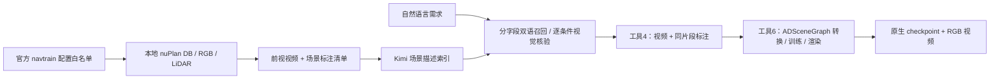

# nuPlan 候选库、自然语言检索与 ADSceneGraph

本分支将有标注的nuPlan基础场景接入工具4和工具6。工具入口保持GitHub版本的薄封装，组件调用位于 `mcp_servers/*/adapter/`。

## 数据如何流转



每个场景的 `scene_manifest.json` 保留8相机的原图引用、标定、曝光时自车位姿，LiDAR身份与位姿，实例track token、类别、逐帧3D位姿/尺寸及地图引用。源相机与LiDAR不是完全同步，保留原始时间戳。缺少的语义mask与SMPL不伪造。

模型生成的中英描述仅用于检索，不作为几何或实例真值。工具4裁剪视频时，同步裁剪时间、帧号和实例编号，保留原始身份；工具6使用同一清单转换真实数据，不依赖Nexus预测结果。

## 本地配置

从仓库根目录操作。检索环境需包含 `mcp_servers/sentry_video_search/requirements.txt` 中的依赖。数据准备的额外依赖见 `mcp_servers/nuplan_data/requirements.txt`。重建复用已有Nexus目录中的nuPlan读取实现及Omniscenegraph代码/环境，不会自动下载或安装它们；没有这些本地依赖时，应先完成部署。

复制 `configs/nuplan_paths.example.json` 为已忽略的 `configs/nuplan_paths.local.json`，填写本机的nuPlan数据根目录、Nexus项目根目录和重建Python路径。也可通过 `NUPLAN_RAW_ROOT`、`ADSCENEGRAPH_PARENT`、`ADSCENEGRAPH_PYTHON` 覆盖。相对路径按仓库根目录解析。

`.env` 只放密钥，依据 `.env.example` 配置：

```dotenv
KIMI_API_KEY="填写自己的密钥"
```

网关、模型、默认库及抽帧设置位于 `configs/video_retriever.json`。当前使用指定网关 `https://apicz.boyuerichdata.com/v1` 和 `kimi-k3`，描述抽4帧、宽512，重排最多4候选且每候选单独请求4帧，同时最多3个视觉请求。`thinking`关闭，索引4并发，连接超时15秒、响应超时90秒。

当前Kimi客户端配置为直连指定网关，按线程复用连接；如果部署环境必须走环境代理，可将 `use_environment_proxy` 改为 `true`。该设置仅用于Kimi调用。只使用chat/completions，不要求embedding接口，也不上传OSS。发往网关的抽样帧和请求会产生API费用；本次公开nuPlan数据处理已获用户授权。

## 从原始数据构建

官方来源为 [WorldEngine sim_engine](https://huggingface.co/datasets/OpenDriveLab/WorldEngine/tree/main/data/sim_engine)，固定版本 `e230eebd77e3add58b2845449592b6e729a69923`。

先取得该版本的 `data/sim_engine/assets/navtrain/configs.tar.gz`；它只包含配置，不需要下载现成高斯场景资产。归档SHA256必须为：

```text
496f719e631c6980d42ae7bf747fa861fcdb66b9328cea876798a64d1ffe0e6c
```

```bash
# SCENE_PY 指向已经部署好ADSceneGraph/nuPlan依赖的Python
PYTHONDONTWRITEBYTECODE=1 "$SCENE_PY" -m mcp_servers.nuplan_data.catalog --official-archive /path/to/configs.tar.gz --count 300
PYTHONDONTWRITEBYTECODE=1 "$SCENE_PY" -m mcp_servers.nuplan_data.prepare --limit 300 --workers 2
```

归档会先验证哈希，然后在本地生成官方白名单元数据；YAML只保留基本类型，不实例化Python对象。候选选择使用固定种子、城市轮询及每log一个场景。选择时的首/中/末检查不等于全片段完整性，准备阶段还会检查逐帧图像与LiDAR。

视频与标注输出到 `mcp_servers/sentry_video_search/data_nuplan/scenes/`。每段前视视频为10秒、10fps、100帧、960×540。图像、LiDAR和地图通过本地原始路径引用，换机器时需要挂载同一数据或重新构建。

本次初选有7个场景缺少中间LiDAR，已从同一官方版本、同一城市补选；补选脚本为 `scripts/nuplan_retrieval/supplement_candidates.py`。最终清单及排除记录在本地 `artifacts/nuplan_retrieval/`，不随代码上传。

## 建库和查询

```bash
PYTHONDONTWRITEBYTECODE=1 environments/video_retriever/.venv/bin/python -m mcp_servers.sentry_video_search.cli index mcp_servers/sentry_video_search/data_nuplan/scenes --library nuplan
PYTHONDONTWRITEBYTECODE=1 environments/video_retriever/.venv/bin/python -m mcp_servers.sentry_video_search.cli search-local "宽阔的城市路口，有交通信号灯和车辆通行" --library nuplan
```

每段先生成中英描述并存入本地SQLite，本地分字段BM25、双语概念与原始查询融合召回后，由Kimi逐条核验原始条件。关键词缓存1天、视觉判断缓存7天；缓存仍受视频/标注/模型/采样身份约束，未知条件不会按满足处理。视频、标注、模型和采样身份一致时复用缓存；网络失败最多自动重试一次，成功项逐条保存，重跑补缺失。认证/权限失败不轮换密钥或模型。没有匹配场景时明确失败，不强行返回无关视频。

默认库是nuplan，工具4可只接收自然语言：

```json
{"requirement":"白天树木较多的城市道路，车流较少，路边有建筑"}
```

返回包含 `video_path`、`scene_id`、`scene_manifest_path`、`match_score`。显式传 `library=default` 或 `library=waymo` 可访问原有库。相关性评分不是命中概率。

## 调用工具6

将工具4返回路径原样传入：

```json
{"backend":"adscenegraph","video_path":"<video_path>","scene_manifest_path":"<scene_manifest_path>","iterations":3000,"cameras":[0]}
```

有清单且未显式指定后端时，自动选择ADSceneGraph；原DGGT入口保留。ADSceneGraph使用版本化标注准备相机、位姿、实例与点云数据，运行原生训练并显式调用eval保存视频。成功结果包含新的 `checkpoint_path`、`rendered_video` 和场景身份。训练完成但导出中断时，可以保留checkpoint恢复渲染。

完整验收入口：

```bash
PYTHONDONTWRITEBYTECODE=1 "$SCENE_PY" scripts/nuplan_retrieval/run_acceptance.py --query "白天树木较多的城市道路，车流较少，路边有建筑" --iterations 3000
```

仅检索加 `--retrieval-only`。每次创建独立运行目录。真实训练需GPU、Omniscenegraph依赖和本地可用原始数据；运行产物只写当前工作区的忽略目录。现有GL库、CUDA扩展及缓存需按本机环境配置，不能把本地编译二进制提交到仓库。

## 检查与边界

```bash
PYTHONDONTWRITEBYTECODE=1 environments/video_retriever/.venv/bin/python -m pytest tests -q
PYTHONDONTWRITEBYTECODE=1 "$SCENE_PY" scripts/nuplan_retrieval/audit_source_references.py
PYTHONDONTWRITEBYTECODE=1 "$SCENE_PY" scripts/nuplan_retrieval/audit_database.py --require-complete-index
```

后两个脚本用于本次冻结的300场景：检查官方身份、时间/标定、视频指纹、原始文件引用、索引关联及覆盖数量。缓存迁移时只允许文件路径重定位，必须核对视频哈希、保留模型/采样签名和原始API响应，不得把测试替身写成真实索引。

已完成实验副本的300场景建库、两条全库查询及两次新场景重建。本GitHub分支的迁移验收另行记录，不以旧版结果代替新版测试。

4帧采样可能遗漏短暂动作；目前验收前视相机，训练视角PSNR不能代表独立测试或新视角质量。缺少mask/SMPL的分支禁用，远景及行人细节可能模糊。纯视觉输入的额外标注工具尚未包含在本次实现中。原生ADSceneGraph checkpoint不能直接作为DGGT PLY进入后续编辑器，仍需专门适配。

数据、索引、密钥、环境和训练产物不提交。协作规则见 [GITHUB_COLLABORATION.md](GITHUB_COLLABORATION.md)。

首次启动时，torchmetrics可能下载AlexNet评估权重。已有缓存时可在本机复制至 `artifacts/nuplan_retrieval/cache/torch/hub/checkpoints/alexnet-owt-7be5be79.pth`；本次复用文件的SHA256为 `7be5be791159472b1fbf3c69796f7cb30dca7ad8466c2df70058c37116cdee02`。它用于图像评估，不是场景高斯模型；权重与编译缓存都不提交。

检索机制升级、复现实验和指标边界见 [NUPLAN_RETRIEVAL_UPGRADE.md](NUPLAN_RETRIEVAL_UPGRADE.md)。
